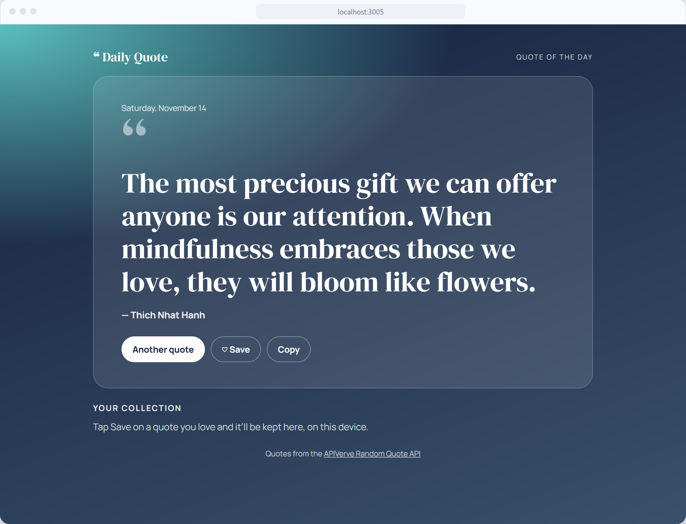

# Quote of the Day | APIVerve Template

[](LICENSE)
[](package.json)
[](tsconfig.json)
[](https://apiverve.com/marketplace/randomquote?utm_source=github&utm_medium=template&utm_campaign=quote-of-the-day-nextjs-tutorial)

A quote-of-the-day app you can deploy in one click. Everyone who opens it that day sees the same quote, set large on a gradient picked from its words. Ask for another whenever you like, copy it, and save the ones you love to a collection that stays on your device.

[](https://vercel.com/new/clone?repository-url=https%3A%2F%2Fgithub.com%2Fapiverve%2Fquote-of-the-day-nextjs-tutorial&project-name=quote-of-the-day&repository-name=quote-of-the-day&env=APIVERVE_API_KEY&envDescription=Your%20APIVerve%20API%20key.%20Free%20to%20create%2C%20no%20card%20needed.&envLink=https%3A%2F%2Fdashboard.apiverve.com%2Fsignup%3Fapi%3Drandomquote%26utm_source%3Dvercel%26utm_medium%3Dtemplate%26utm_campaign%3Dquote-of-the-day-nextjs-tutorial)



---

### Get your free API key

This template needs an APIVerve API key. **[Sign up free](https://dashboard.apiverve.com/signup?api=randomquote&utm_source=github&utm_medium=template&utm_campaign=quote-of-the-day-nextjs-tutorial)**, no credit card required.

---

## Deploy in one click

Click **Deploy with Vercel** above. Vercel copies this repo to your GitHub account, asks for your `APIVERVE_API_KEY`, and gives you a live URL about a minute later.

## Run it locally

```bash
git clone https://github.com/apiverve/quote-of-the-day-nextjs-tutorial.git
cd quote-of-the-day-nextjs-tutorial
npm install
cp .env.example .env   # then set APIVERVE_API_KEY in .env
npm run dev
```

Open `http://localhost:3000`. To see it in a phone and a browser frame side by side, open `http://localhost:3000/showcase.html`.

## How it works

1. `components/Quotes.tsx` is the page. It calls `/api/quote` for today’s quote, or `/api/quote?fresh=1` when you ask for another.
2. `app/api/quote/route.ts` checks the input, then calls Random Quote. Your API key stays on the server and never reaches the browser. Answers are cached for the rest of the day (today’s quote only; fresh quotes are never cached), and cached answers don't count against the rate limit.
3. The page hashes the quote’s text to pick one of six gradients, so the same quote always gets the same look. Saved quotes are kept in `localStorage`.

Everything here works on a free key: Random Quote returns the quote and its author on every plan.

```
app/
  api/quote/route.ts    the server route: today's quote (cached) or a fresh one
  layout.tsx            fonts and metadata
  page.tsx
  globals.css
components/
  Quotes.tsx            the app
lib/
  apiverve.ts           key, rate limit, cache and the API call
public/
  showcase.html         the phone and desktop demo frame
```

### The API call

```ts
const res = await fetch('https://api.apiverve.com/v1/randomquote', {
  headers: { 'x-api-key': process.env.APIVERVE_API_KEY! }
});
const { data } = await res.json();
```

## Before you share your URL

Once deployed, anyone who finds your URL can use it on your API key. Each visitor can make 10 uncached requests a minute, and repeat lookups come from the cache, which is fine for a demo. Both are kept in memory, so they aren't shared between serverless instances. For production:

- Put the page behind your own sign-in, or
- Move the limit and cache to a shared store such as [Upstash Redis](https://upstash.com/), or
- Call the route only from your own backend.

## Ideas to extend it

- Show the quote in the reader’s language with [Translator](https://apiverve.com/marketplace/translator?utm_source=github&utm_medium=template&utm_campaign=quote-of-the-day-nextjs-tutorial).
- Turn a quote into a shareable image with [HTML to Image](https://apiverve.com/marketplace/htmltoimage?utm_source=github&utm_medium=template&utm_campaign=quote-of-the-day-nextjs-tutorial).
- Pick quotes by mood with [Sentiment Analysis](https://apiverve.com/marketplace/sentimentanalysis?utm_source=github&utm_medium=template&utm_campaign=quote-of-the-day-nextjs-tutorial).

## API reference

- [Random Quote](https://apiverve.com/marketplace/randomquote?utm_source=github&utm_medium=template&utm_campaign=quote-of-the-day-nextjs-tutorial): `GET https://api.apiverve.com/v1/randomquote`
- [Full documentation](https://docs.apiverve.com?utm_source=github&utm_medium=template&utm_campaign=quote-of-the-day-nextjs-tutorial)

## Tech stack

- **Next.js 16** (App Router) and **React 19**, in **TypeScript**
- A **Route Handler** in `app/api/` for the server side, so the key never reaches the browser
- Deploys to Vercel as-is, with no configuration

## License

MIT. See [LICENSE](LICENSE).
